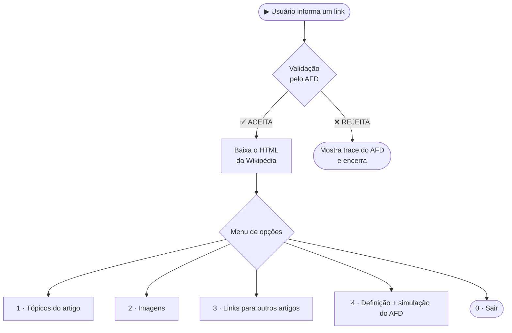
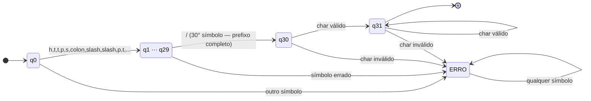
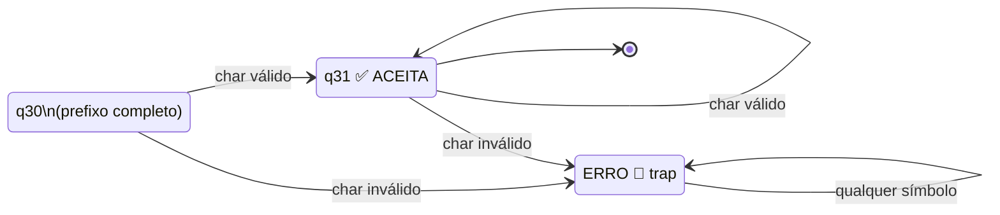
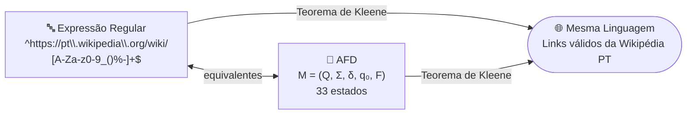

# 🕷️ Web Scraping da Wikipedia com Expressões Regulares e AFD

> **Projeto 1 — Linguagens Formais e Compiladores**  
> Curso de Ciência da Computação · 6º Período

---

## 📋 Sumário

- [Sobre o Projeto](#-sobre-o-projeto)
- [Como Funciona](#-como-funciona)
- [Expressão Regular (ER)](#-expressão-regular-er)
- [Autômato Finito Determinístico (AFD)](#-autômato-finito-determinístico-afd)
- [Equivalência ER ↔ AFD](#-equivalência-er--afd)
- [Funcionalidades do Scraper](#-funcionalidades-do-scraper)
- [Como Usar](#-como-usar)
- [Exemplos de Execução](#-exemplos-de-execução)
- [Requisitos](#-requisitos)

---

## 🧠 Sobre o Projeto

Este projeto une **teoria de linguagens formais** com uma aplicação prática real: um **web scraper** da Wikipédia em português.

O grande diferencial é a validação do link informado pelo usuário: em vez de usar diretamente a biblioteca `re` do Python, construímos **manualmente** um **Autômato Finito Determinístico (AFD)** que reconhece exatamente a mesma linguagem que a expressão regular abaixo.

$$\texttt{\^{}https://pt\backslash.wikipedia\backslash.org/wiki/[A\text{-}Za\text{-}z0\text{-}9\\_()\\%\\-]+\$}$$

Isso conecta os conceitos vistos em sala (ER, AFD, simulador de autômato, linguagens regulares) a um caso de uso real.

---

## ⚙️ Como Funciona



---

## 🔤 Expressão Regular (ER)

A ER utilizada para validar os links da Wikipédia é:

$$\underbrace{\texttt{\^{}https://pt\backslash.wikipedia\backslash.org/wiki/}}_{\text{prefixo fixo obrigatório}}\underbrace{\texttt{[A\text{-}Za\text{-}z0\text{-}9\\_()\\%\\-]}}_{\text{classe de caracteres válidos}}\underbrace{\texttt{+}}_{\geq 1}\underbrace{\texttt{\$}}_{\text{fim}}$$

### Anatomia da ER

| Fragmento | Tipo | Significado |
|---|---|---|
| `^` | Âncora | Início da cadeia |
| `https://pt` | Literal | Protocolo e subdomínio |
| `\.wikipedia\.org/wiki/` | Literal (`.` escapado) | Domínio e caminho fixo |
| `[A-Za-z0-9_()\%\-]` | Classe de caracteres | Caracteres válidos do artigo |
| `+` | Quantificador | Um ou mais ocorrências |
| `$` | Âncora | Fim da cadeia |

### Classe de Caracteres

```
[A-Za-z0-9_()\%\-]
 ├─ A-Z   letras maiúsculas
 ├─ a-z   letras minúsculas
 ├─ 0-9   dígitos
 ├─ _     underscore  → ex: São_Paulo
 ├─ ( )   parênteses  → ex: Mercurio_(planeta)
 ├─ %     percent     → ex: S%C3%A3o_Paulo (URL encoding)
 └─ -     hífen       → ex: Jean-Paul_Sartre
```

### Tabela de Exemplos

| Link | Válido? | Motivo |
|---|---|---|
| `https://pt.wikipedia.org/wiki/Python` | ✅ | Formato correto |
| `https://pt.wikipedia.org/wiki/S%C3%A3o_Paulo` | ✅ | `%` e `_` permitidos |
| `https://pt.wikipedia.org/wiki/Mercurio_(planeta)` | ✅ | Parênteses permitidos |
| `https://pt.wikipedia.org/wiki/` | ❌ | Artigo vazio — `+` exige ≥ 1 char |
| `https://en.wikipedia.org/wiki/Python` | ❌ | `en` ≠ `pt` |
| `http://pt.wikipedia.org/wiki/Python` | ❌ | `http` sem `s` |
| `https://pt.wikipedia.org/wiki/Foo#Bar` | ❌ | `#` não está na classe |

---

## 🤖 Autômato Finito Determinístico (AFD)

### Definição Formal

$$M = (Q,\ \Sigma,\ \delta,\ q_0,\ F)$$

$$Q = \{q_0,\ q_1,\ \ldots,\ q_{30},\ q_{31},\ q_{\text{erro}}\}$$

$$\Sigma = \text{caracteres ASCII imprimíveis}$$

$$q_0 = \text{estado inicial}$$

$$F = \{q_{31}\} \quad \text{— único estado de aceitação}$$

### Lógica dos Estados

| Estado | Significado |
|---|---|
| $q_0$ | Estado inicial |
| $q_1 \ldots q_{29}$ | Lendo o prefixo `https://pt.wikipedia.org/wiki/` caractere a caractere |
| $q_{30}$ | Prefixo completo — aguarda **1º caractere** do artigo |
| $q_{31}$ | ✅ **Estado de aceitação** — lendo os demais caracteres do artigo |
| $q_\text{erro}$ | 🚫 **Estado poço (trap)** — cadeia inválida, sem retorno possível |

---

### Diagrama — Visão Geral



> `char válido` = qualquer caractere de `[A-Za-z0-9_()\%\-]`

---

### Diagrama — Detalhe do Prefixo (q0 → q10)

```mermaid
stateDiagram-v2
    direction LR

    [*] --> q0
    q0  --> q1  : h
    q1  --> q2  : t
    q2  --> q3  : t
    q3  --> q4  : p
    q4  --> q5  : s
    q5  --> q6  : ":"
    q6  --> q7  : /
    q7  --> q8  : /
    q8  --> q9  : p
    q9  --> q10 : t
    q10 --> q11 : .
    q11 --> q12 : w
    q12 --> q13 : i
    q13 --> q14 : k
    q14 --> q15 : i
    q15 --> q16 : p
    q16 --> q17 : e
    q17 --> q18 : d
    q18 --> q19 : i
    q19 --> q20 : a
```



---

### Diagrama — Estados de Aceitação e Erro



---

### Função de Transição δ

$$\delta(q_i,\ \text{PREFIXO}[i]) = q_{i+1}, \quad 0 \leq i \leq 29$$

$$\delta(q_i,\ c) = q_\text{erro}, \quad 0 \leq i \leq 29,\ c \neq \text{PREFIXO}[i]$$

$$\delta(q_{30},\ c) = \begin{cases} q_{31} & \text{se } c \in [A\text{-}Za\text{-}z0\text{-}9\\_()\\%\\-] \\ q_\text{erro} & \text{caso contrário} \end{cases}$$

$$\delta(q_{31},\ c) = \begin{cases} q_{31} & \text{se } c \in [A\text{-}Za\text{-}z0\text{-}9\\_()\\%\\-] \\ q_\text{erro} & \text{caso contrário} \end{cases}$$

$$\delta(q_\text{erro},\ c) = q_\text{erro}, \quad \forall c \in \Sigma \quad \text{(poço)}$$

---

### Simulação Passo a Passo

#### ✅ Link válido — `https://pt.wikipedia.org/wiki/Python`

```
inicio -> q0
  le 'h' : q0  -> q1
  le 't' : q1  -> q2
  le 't' : q2  -> q3
  le 'p' : q3  -> q4
  le 's' : q4  -> q5
  le ':' : q5  -> q6
  le '/' : q6  -> q7
  le '/' : q7  -> q8
  le 'p' : q8  -> q9
  le 't' : q9  -> q10
  ...
  le '/' : q29 -> q30   ← prefixo completo!
  le 'P' : q30 -> q31   ← 1º char do artigo → entra em ACEITA
  le 'y' : q31 -> q31
  le 't' : q31 -> q31
  le 'h' : q31 -> q31
  le 'o' : q31 -> q31
  le 'n' : q31 -> q31

  Terminou em q31 ✅ ACEITA
```

#### ❌ Link inválido — `https://en.wikipedia.org/wiki/Python`

```
inicio -> q0
  le 'h' : q0  -> q1
  le 't' : q1  -> q2
  le 't' : q2  -> q3
  le 'p' : q3  -> q4
  le 's' : q4  -> q5
  le ':' : q5  -> q6
  le '/' : q6  -> q7
  le '/' : q7  -> q8
  le 'e' : q8  -> ERRO  ← esperava 'p' (de "pt."), recebeu 'e'

  Caiu no estado de ERRO: a cadeia é ❌ REJEITADA.
```

---

## 🔄 Equivalência ER ↔ AFD

Pelo **Teorema de Kleene**, toda linguagem regular pode ser descrita tanto por uma **Expressão Regular** quanto por um **Autômato Finito**:



No código, os dois métodos são executados e comparados — e **sempre concordam**:

```python
valido_afd   = validar_link_afd(link)    # AFD construído à mão
valido_regex = validar_link_regex(link)  # re.match() do Python
# resultado: sempre concordam ✅
```

---

## 🕵️ Funcionalidades do Scraper

### ERs usadas na extração

| Funcionalidade | Expressão Regular |
|---|---|
| Bloco do índice | `<div class="vector-toc-text".*?>[\s\S]*?</div>` |
| Título do tópico | `<span>(.*?)</span>` |
| Figuras | `<figure[\s\S]*?</figure>` |
| Nome da imagem | `src="[^"]*/([^/]+\.(?:jpg\|png\|svg\|jpeg))"` |
| Links internos | `href="(/wiki/[^":#]+)"` |

### Menu de opções

| Opção | O que faz |
|---|---|
| `1` | Lista todos os tópicos do índice do artigo |
| `2` | Lista todas as imagens (figuras + infobox) |
| `3` | Lista links para outros artigos da Wikipédia |
| `4` | Exibe definição formal do AFD + simulação estado a estado |
| `0` | Encerra o programa |

---

## 🚀 Como Usar

### Pré-requisitos

- Python **3.6+** — sem dependências externas (apenas bibliotecas padrão)

### Executando

```bash
python web_scraping_er_afd.py
```

### Exemplo de sessão

```
Digite o link do artigo da Wikipedia: https://pt.wikipedia.org/wiki/Linguagem_formal

Link valido! (reconhecido pelo AFD construido a mao)
Conferencia -> AFD=True | regex=True | concordam

MENU
1 - Listar topicos do artigo
2 - Listar imagens
3 - Listar links para outros artigos
4 - Mostrar o AFD da validacao (definicao + simulacao)
0 - Sair

Escolha uma opcao:
```

---

## 📦 Requisitos

| Biblioteca | Versão | Uso |
|---|---|---|
| `urllib` | built-in | Download do HTML |
| `re` | built-in | Expressões regulares |
| `string` | built-in | Conjunto de caracteres ASCII |

Nenhuma instalação extra necessária. ✅

---

## 📚 Conceitos de LFC Aplicados

| Conceito | Onde aparece no código |
|---|---|
| Expressão Regular | `validar_link_regex()` — padrão `r"^https://..."` |
| AFD — definição formal $M=(Q,\Sigma,\delta,q_0,F)$ | `descrever_afd()` |
| Função de transição $\delta$ | `delta(estado, c)` — implementada como função Python |
| Estado poço (trap state) | Constante `TRAP = -1`, retorno imediato em `validar_link_afd()` |
| Simulador de AFD | `mostrar_trace(link)` — percorre a cadeia símbolo a símbolo |
| Teorema de Kleene | Comparação entre AFD e `re.match()` — sempre concordam |

---

<div align="center">

Feito com 🧠 teoria e 🐍 Python  

**Linguagens Formais e Compiladores — 2026**

</div>